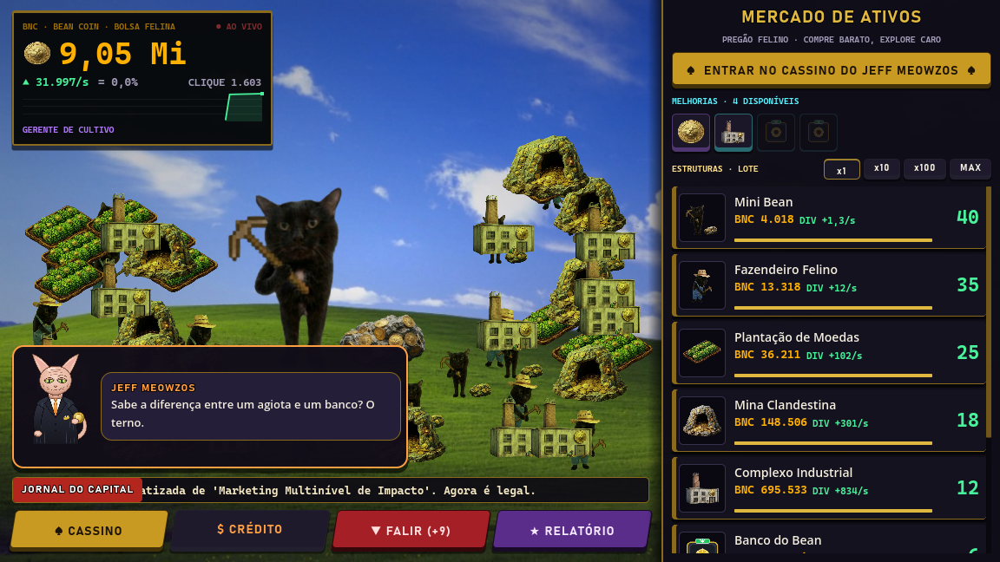

# 🐾 BeanClicker — Capitalism at its finest

Idle/clicker satírico feito em **Godot 4.7** sobre trabalho precarizado, especulação e vício em apostas, estrelando gatos.
Projeto da disciplina **PAC (Projeto de Aprendizagem Colaborativa)**. A gestão de configuração do repositório segue o [Plano de Gerenciamento de Configuração (PGC)](docs/PGC_BeanClicker.md).

**Equipe:** Abner, Athos, Lucas Scheibe, Raoni, Ruan Vitor e Vitor Kill.



---

## Estrutura do repositório

```
BeanClicker/
├── game/                  # Projeto Godot (abra o project.godot daqui)
│   ├── project.godot      # configuração do projeto e versão da engine (4.7)
│   ├── Main.tscn, main.gd # cena principal (HUD, Grande Bean, toasts)
│   ├── GameManager.gd     # autoload: economia, Falência, cassino, autosave
│   ├── Meowzos.gd         # autoload: empréstimos e falas do Jeff Meowzos
│   ├── SaveSystem.gd      # save JSON versionado (v3)
│   ├── casino/            # um script por mini-jogo (herdam CasinoGame)
│   ├── data/              # GameData.gd: números de balanceamento e textos
│   ├── ui/                # painéis de interface e tema visual (UIKit)
│   └── images/, *.mp3     # sprites e sons
├── docs/
│   ├── PGC_BeanClicker.md # Plano de Gerenciamento de Configuração
│   ├── GDD_BeanClicker.md # Game Design Document (versão editável)
│   ├── GDD_BeanClicker.pdf
│   └── screenshots/       # capturas das telas
├── .github/               # template de PR, CODEOWNERS e templates de Issue
├── .gitignore
└── .gitattributes
```

## Como executar

**Requisito:** [Godot Engine 4.7](https://godotengine.org/download) (versão fixada em `game/project.godot`).

1. Clone o repositório:
   ```bash
   git clone https://github.com/RuanVMartins/BeanClicker.git
   ```
2. Abra o Godot 4.7 → **Importar** → selecione `game/project.godot`.
3. Pressione **F5** para rodar.

Para gerar o executável: **Projeto → Exportar → Windows Desktop**. Os builds (`.exe`/`.pck`) **não** são versionados: eles são publicados em *Releases*.

O save fica em `%APPDATA%\Godot\app_userdata\BeanClicker\beanclicker_save.json` (apague para recomeçar).

## Como testar

O projeto ainda não tem testes automatizados (previstos no PGC, seção 5). Hoje o teste é manual:

- rodar o jogo (F5) e verificar a tela principal, a loja, o cassino (7 jogos), o crédito e a Falência;
- conferir no painel **Output** do Godot que não há erros de script;
- fechar e reabrir o jogo para validar o autosave.

## Como contribuir

1. Abra uma **Issue** (templates de Funcionalidade ou Defeito).
2. Crie uma branch `feature/<issue>-<descricao>` (ou `fix/...`).
3. Faça commits no padrão **Conventional Commits** (`feat(casino): adiciona roleta`).
4. Abra um **Pull Request** para a `main`. A `main` é protegida: só recebe mudanças por PR com **1 aprovação** do par de revisão (merge por *squash*).

## Controles

Clique no Grande Bean para produzir moedas e compre estruturas na loja à direita. **ESC** fecha a janela aberta. As estruturas no cenário podem ser arrastadas.

## Documentação

- [PGC — Plano de Gerenciamento de Configuração](docs/PGC_BeanClicker.md)
- [GDD — Game Design Document](docs/GDD_BeanClicker.md)
