# 🐾 GAME DESIGN DOCUMENT (GDD) — BEANCLICKER
**Versão do Documento:** 3.1 (Cassino do Jeff Meowzos, Falência Declarada & Pesque-Pague)
**Engine:** Godot Engine 4.7 (GDScript 2.0)
**Gênero:** *Incremental Clicker* / Simulação Econômica Satírica com Mini-Jogos de Apostas
**Plataforma:** PC / Desktop (Windows, macOS, Linux)
**Instituição / Contexto:** Projeto Universitário (PAC Extensionista)
**Integrantes / Equipe:** Abner, Athos, Lucas Scheibe, Raoni, Ruan Vitor, Vitor Kill

---

## 1. VISÃO GERAL DO PROJETO

### 1.1. Ficha Técnica
| Atributo | Detalhes |
| :--- | :--- |
| **Título Oficial** | **BeanClicker** |
| **Versão** | **2.1** (executável) / GDD 3.1 |
| **Equipe** | **Abner, Athos, Lucas Scheibe, Raoni, Ruan Vitor, Vitor Kill** |
| **Gênero** | Idle / Incremental Clicker com Mini-Jogos de Cassino |
| **Motor de Jogo** | Godot Engine 4.7 (Forward Plus / GDScript 2.0) |
| **Resolução Base** | 1152 × 648 (escalonável via Canvas Items) |
| **Modo de Jogo** | Single-Player Offline (save local em JSON, autosave a cada 30 s) |
| **Classificação Indicativa** | 12+ (Apostas Virtuais Fictícias / Sem Dinheiro Real) |

### 1.2. Logline
*BeanClicker* é um incremental no estilo *Cookie Clicker* com humor ácido sobre capitalismo extremo, exploração do trabalho e vício em apostas. O jogador é sócio do **Grande Bean**, um gato magnata que enriquece com estagiários clonados, fazendas, minas, bancos e criptomoedas. Nas sombras opera o **Cassino do Jeff Meowzos**, um gato sphynx bilionário e agiota que oferece sete jogos de azar e crédito com juros por minuto. Quando a empresa fica grande demais, o jogador declara **Falência**, desvia o lucro para fundos offshore e volta como um CEO mais agressivo.

### 1.3. Pilares de Design
1. **Loop Viciante e Recompensador:** toda ação tem retorno audiovisual (contador animado, moedas espirrando, partículas, squash & stretch) e o jogador sempre vê quanto falta para a próxima compra.
2. **Sátira com Personalidade Própria:** o tom é cínico, divertido e levemente sombrio. Piadas autorais em manchetes, descrições, falas do Meowzos e nomes de sistemas.
3. **Matemática Honesta, Casa Vencedora:** todo jogo do cassino tem RTP (retorno ao jogador) calculado exatamente e abaixo de 100%. O jogo não deixa brechas de dinheiro infinito.
4. **Risco como Escolha:** cada mini-jogo oferece um perfil de volatilidade diferente; os empréstimos são armadilhas transparentes.

---

## 2. PÚBLICO-ALVO & CLASSIFICAÇÃO

* **Primário:** fãs de *Cookie Clicker*, *Adventure Capitalist* e *Universal Paperclips*.
* **Secundário:** jovens de 16 a 30 anos atraídos pelo humor corporativo e pela estética felina.
* **Terciário:** estudantes e educadores que usam o cassino para discutir probabilidade, risco e a vantagem da banca.
* **Classificação 12+:** apostas exclusivamente com moeda fictícia (*Bean Coins*), sem compras, microtransações ou conversão em dinheiro real.

---

## 3. IDENTIDADE VISUAL: "CASINO NOIR CORPORATIVO"

| Cor | Hex | Uso |
| :--- | :--- | :--- |
| Ouro Imperial | `#E0B840` | Molduras, moedas, botões principais, jackpots |
| Roxo Noturno | `#14121F` | Fundo dos painéis e modais |
| Feltro | `#241E38` | Balões de fala e painéis internos |
| Feltro Verde | `#0F3B2E` | Mesa dos mini-jogos |
| Verde Lucro | `#48F29A` | Ganhos, saque a tempo, produção |
| Vermelho Risco | `#FF4D4D` | Perdas, explosões, dívida, Falência |
| Ciano Offshore | `#5CF2FF` | Melhorias e Benefícios Executivos |
| Laranja Meowzos | `#FF9F43` | Tudo que pertence ao Jeff Meowzos |
| LED Âmbar | `#FFB000` | Cotações, preços e o saldo no HUD |

**Linguagem visual: terminal de bolsa + máquina de cassino.**
* **HUD de cotação:** o saldo aparece como uma ação na bolsa ("BNC · Bean Coin"), em LED âmbar e fonte monoespaçada, com indicador "ao vivo" piscando, variação % do último minuto e um gráfico sparkline verde/vermelho.
* **Teclas físicas:** todo botão tem borda inferior grossa (profundidade) e afunda 3 px ao ser pressionado, como os botões de uma slot machine. Na barra de ações eles são inclinados, como bilhetes de aposta.
* **Molduras art déco:** cantos de 2–4 px, bordas superior e inferior mais grossas e sombra dura deslocada, sem desfoque. A cara é de material impresso, não de glow genérico.
* **Letreiro de lâmpadas:** o cassino é contornado por lâmpadas em efeito de perseguição, que piscam todas juntas em prêmios de 5x ou mais.
* **Mercado de Ativos:** os cards de estrutura têm tarja lateral dourada, preço em "BNC" e produção mostrada como "DIV" (dividendo).
* **Detalhes:** a moeda do jogo serve de puxador do slider de aposta e os tooltips imitam uma fita de cotação.
* Tema global em código (`ui/UIKit.gd`), aplicado na raiz de cada CanvasLayer, porque a herança de Theme do Godot não atravessa CanvasLayer.
* Fontes: *Bahnschrift* com espaçamento largo para títulos (letreiro) e *Cascadia Mono/Consolas* para números.
* Corrida de Ratos: os ratos são sprites (`images/rat.png`), espelhados com `flip_h` para correr para a direita, galopando sobre uma pista de terra batida.

---

## 4. NARRATIVA & PERSONAGENS

### 4.1. O Grande Bean
Gato preto de olhar entediado, dono do império. Clicar nele é "extrair mais-valia".

### 4.2. Jeff Meowzos — o Gato Gerente
Gato **sphynx** (careca, enrugado, orelhas gigantes) de terno risca de giz, gravata laranja e lenço de bolso dourado, sempre com uma moeda na pata. Bilionário, dono do cassino e agiota "licenciado por ele mesmo". A careca, segundo ele, "é aerodinâmica".
* **Papel:** recepciona o jogador, narra os jogos, reage a cada resultado, oferece empréstimos, cobra dívidas e comenta a economia.
* **Onde aparece:** no topo do cassino, no Escritório de Crédito e passeando pela tela principal a cada 55–95 s.
* **Humor no corpo:** balança quando debocha, treme e avermelha quando cobra, pula quando se assusta com uma vitória grande, murcha quando você quita uma dívida.
* **Falas marcantes:**
  * "Ah, meu cliente favorito! O favorito é sempre o que ainda tem saldo."
  * "Quase! 'Quase' é minha palavra favorita. Rende muito."
  * "Sabe a diferença entre um agiota e um banco? O terno."
  * "Quitou? Tudo? ...Que decepção. Volte sempre."
  * "Enquanto você dormia, seus estagiários trabalharam. Eu cobrei só 75% de 'taxa de administração'."

### 4.3. Jornal do Capital
Faixa de manchetes satíricas rolando na tela principal. 30 manchetes fixas e manchetes dinâmicas sobre o império do jogador ("Dívida do jogador com Jeff Meowzos chega a 19 Mi. Agiota nega ser agiota: 'sou fintech'").

---

## 5. CORE LOOP

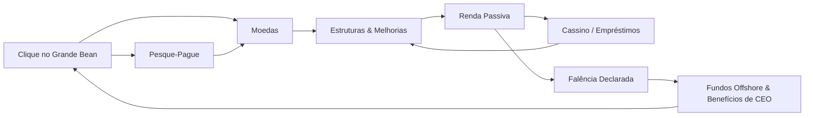

1. **Clique:** cada clique produz `poder de clique` + `% do CPS` (melhorias Toque de Midas, Mouse de Ouro, Dedo do CEO). 4% dos cliques são **Cliques Executivos** e valem x8.
2. **Renda passiva:** acumulada a 10 Hz pelo `GameManager`.
3. **Cassino e crédito:** aceleram ou destroem o caixa. Não contam para a Falência.
4. **Pescaria:** jogo ativo que rende em proporção à sua renda. Conta como renda produtiva.
5. **Falência:** reinicia a carreira em troca de multiplicadores permanentes.

---

## 6. ESTRUTURAS DE PRODUÇÃO

Preço: $Preço(N) = Base \times 1.15^N$ (com desconto de 10% pelo benefício *Demissão em Massa*). Compra em lotes **x1, x10, x100 ou MAX**. Estruturas ainda não alcançadas aparecem como "???".

| Estrutura | Custo Base | CPS Unitário | Sátira |
| :--- | :--- | :--- | :--- |
| **Mini Bean** | 15 | 0,1 | Estagiários clonados na escala 6x1 pelo sonho da efetivação. |
| **Fazendeiro Felino** | 100 | 1 | Cultiva moedas para pagar o aluguel do arranhador. |
| **Plantação de Moedas** | 1.100 | 8 | O agro é tech, o agro é pop, o agro é isento. |
| **Mina Clandestina** | 12.000 | 47 | Laudo de segurança assinado pelo próprio Bean. |
| **Complexo Industrial** | 130.000 | 260 | O sindicato virou sala de descompressão com pufe. |
| **Banco do Bean** | 1,4 Mi | 1.400 | Não produz nada, por isso rende tanto. |
| **Ração Ultraprocessada S.A.** | 20 Mi | 7.800 | 0% atum, 100% sabor de atum. |
| **Fazenda de MiauCoin** | 330 Mi | 44.000 | Lastreada em absolutamente nada. |

---

## 7. MELHORIAS

* **Melhorias de estrutura:** 4 por estrutura (32 no total), liberadas com 1, 5, 25 e 50 unidades, custando 10x, 50x, 500x e 5.000x o preço base. Cada uma dobra a produção daquela estrutura. Exemplos: *Pizza na Sexta*, *Barragem 'Segura'*, *Grande Demais Pra Quebrar*, *Pump & Dump*.
* **Melhorias de clique:** Dedo Biônico (+1), Dedo de Titânio (+1), Toque de Midas (+5% do CPS), Mouse Banhado a Ouro (+5% do CPS).
* **Melhorias globais:** Bean Cósmico (x1,5 e operários em neon), Reforma Trabalhista (x1,25), Terceirização Total (x1,5).
* Na loja, as melhorias ficam numa vitrine de ícones ordenada por preço, com tooltip de efeito e descrição.

---

## 8. FALÊNCIA DECLARADA (PRESTÍGIO)

### 8.1. Fórmulas
* **Fundos Offshore ganhos** $= \lfloor \sqrt{\text{Produção Histórica} / 1.000.000} \rfloor - \text{Fundos já obtidos}$
* **Multiplicador de prestígio** $= (1 + 0{,}02 \times \text{Fundos}) \times (1 + 0{,}05 \times \text{Falências})$
* **Conquistas:** +1% de produção cada ("Prestígio de LinkedIn").

Só renda **produtiva** (clique, CPS, offline) conta para a Produção Histórica. Dinheiro de aposta move o saldo, mas não o histórico. Isso fecha a brecha da versão anterior, em que empates no 21 inflavam o prestígio.

### 8.2. O que acontece ao falir
* Caixa, estruturas e melhorias são "liquidados".
* **Dívidas com o Jeff Meowzos são perdoadas** ("calote estratégico").
* O jogador ganha um novo título: Gerente de Cultivo → CEO Recém-Falido → CEO Reincidente → Empreendedor Serial → Magnata Laranja → Too Big To Fail → Entidade Offshore → O Próprio Mercado.
* A tela imita um pedido de falência em papel, assinado "com a pata", com carimbo **FALIDO**.

### 8.3. Benefícios Executivos (pagos com Fundos Offshore, permanentes)
| Benefício | Custo | Efeito |
| :--- | :---: | :--- |
| Herança do Papai | 1 | Começa cada carreira com 25.000 moedas e o cassino liberado |
| Dedo do CEO | 2 | Cliques valem +3% do CPS |
| Demissão em Massa | 3 | Estruturas 10% mais baratas |
| Paraíso Fiscal | 3 | Renda offline 75% (era 25%), limite 8 h (era 2 h) |
| Amigo do Agiota | 4 | Juros pela metade, limite de crédito em dobro |
| Monopólio | 4 | Melhorias 25% mais baratas |
| Lobby em Brasília | 6 | x1,25 em toda a produção |
| Socorro Estatal | 6 | Saldo zerado → governo deposita 10 min de CPS (recarga 10 min) |
| Crupiê Subornado | 8 | +3% em todos os prêmios do cassino |
| Calote Profissional | 10 | Na inadimplência, o Meowzos só leva o caixa |
| Paraquedas Dourado | 12 | Ao falir, mantém 10% de cada estrutura |

---

## 9. CASSINO DO JEFF MEOWZOS

### 9.1. Interface
* Desbloqueio: 1.000 moedas. Abre com animação de queda e quique.
* **Seletor de aposta:** slider logarítmico (preciso em apostas pequenas e grandes) e fichas ½, 2x, 1%, 10%, 25%, 50%, MIN e ALL-IN. Mostra a aposta como % do saldo e em tempo de renda.
* Estatísticas da sessão e vitalícias, incluindo o **RTP pessoal** do jogador.
* Botão do Escritório de Crédito sempre à vista (e piscando quando falta saldo).

### 9.2. Regra Financeira
1. `place_bet()` debita a aposta no início da rodada.
2. `settle_bet(jogo, aposta, pagamento_bruto)` credita o prêmio, atualiza estatísticas, dispara conquistas e o comentário do Meowzos.
3. Todo jogo herda `CasinoGame` e só usa `take_bet()` e `settle()`.

### 9.3. Os 7 Jogos
| Jogo | RTP | Regras |
| :--- | :---: | :--- |
| **Caça-Níquel Corporativo** | 93,6% | 3 rolos ponderados com símbolos do império. 3 iguais pagam 8x a 250x; 2 Beans Cósmicos 6x; 1 Bean devolve a aposta. Auto-giro x10. |
| **Foguetinho** | 96% | $Crash = 0{,}96 / (1-u)$, logo $P(crash \ge m) = 0{,}96/m$: qualquer estratégia de saque tem o mesmo RTP. Auto-saque opcional, gráfico ao vivo e histórico. |
| **21 Felino** | ~97% | Baralho infinito, dealer para no 17, Blackjack 3:2, dobrar com 2 cartas. 5% de "taxa de conveniência" sobre o lucro. |
| **Roleta Clandestina** | 92,3% | 13 casas. Vermelho, Preto, Baixo (1-6) e Alto (7-12) pagam 2x; Verde e Número exato pagam 12x. |
| **Raspadinha do Trabalhador** | 91% | Resultado sorteado na compra; 3 valores iguais pagam até 100x. Cartões perdedores mostram dois "100x" em 55% das vezes (near-miss proposital, satirizando a indústria). |
| **Corrida de Ratos** | 94% | 5 ratos com odds fixas (pagamento = 0,94 / probabilidade). O Herdeiro Nepo larga 25% à frente "porque o pai é dono da pista". |
| **Esquema Pirâmide** | 96% | Cada recrutamento tem 72% de chance; multiplicador no nível n = $0{,}96 / 0{,}72^n$ (até 25,6x). Saque quando quiser; se falhar, a pirâmide desaba. |

### 9.4. Correções em relação à versão 2.0 do GDD
* O Foguetinho antigo ($1{,}01 + u^{2{,}8} \times 8{,}99$) tinha RTP de ~127% sacando em 4-5x: dinheiro infinito.
* Na Roleta antiga, Vermelho e Ímpar eram a mesma aposta (a roda colore pela paridade).
* No 21 antigo, o Blackjack do jogador pagava 2,5x mesmo contra Blackjack do dealer.
* Os símbolos de emoji compostos do Caça-Níquel (7️⃣) apareciam como quadrados; agora os rolos usam as artes do jogo.

---

## 10. EMPRÉSTIMOS DO JEFF MEOWZOS

O valor emprestado é medido em **minutos de renda** (CPS × 60, mínimo 200/min), então escala sozinho ao longo do jogo.

| Oferta | Valor | Juros | Prazo | Deve no fim |
| :--- | :---: | :---: | :---: | :---: |
| Consignado Felino | 10 min de renda | 3% ao minuto | 10 min | ~1,34x |
| Crédito Pré-Aprovado | 30 min de renda | 7% ao minuto | 6 min | ~1,50x |
| Agiotagem Raiz | 90 min de renda | 15% ao minuto | 4 min | ~1,75x |

* Juros compostos contínuos; pagamento parcial ou total a qualquer momento; um empréstimo por vez.
* **Inadimplência:** o Meowzos leva o caixa e **penhora até 75% de cada estrutura** (as mais caras primeiro, avaliadas em 50% do preço). **Mini Beans são impenhoráveis** ("bem de família, afinal aqui somos uma família"). O que sobrar é perdoado e o nome fica sujo por 5 minutos.
* **Raciocínio:** os juros tornam o empréstimo lucrativo só para investir cedo (Consignado) ou para apostar (Agiotagem). É uma armadilha honesta: todos os números ficam visíveis antes de aceitar.

---

## 11. PESQUE-PAGUE DO JEFF (PESCARIA)

O lago é do Jeff Meowzos, a vara é sua e o atravessador também é ele. Abre pelo botão **≈ PESCA** ou pela tecla **P**.

### 11.1. Loop
1. **Lançar a linha** (ESPAÇO ou botão). A boia cai no lago.
2. **Esperar a fisgada** (1,4 a 4 s). Puxar antes da hora espanta o peixe: "O peixe riu da sua cara e mudou de lago."
3. **Puxar** dentro da janela de fisgada (~0,95 s, maior com varas melhores). Se demorar, o peixe "foi trabalhar numa concorrente".
4. **Barra de tensão:** um marcador vai e volta; é preciso clicar quando ele estiver na zona colorida. Errar arrebenta a linha ("material terceirizado").
5. O peixe vai para a **cesta** (10 vagas). Com a cesta cheia, não dá para pescar até vender: isso impede a pesca no automático.
6. **Vender** quando a **Cotação do Pescado** estiver boa. O Jeff fica com 10% de "atravessador".

### 11.2. Raridades
| Raridade | Chance base | Valor (segundos de renda) | Acertos na barra | Zona | Peixes |
| :--- | :---: | :---: | :---: | :---: | :--- |
| Comum | 70% | 8 s | 1 | 30% | Sardinha CLT, Lambari Estagiário, Tilápia Terceirizada, Bagre do Home Office |
| Raro | 22% | 45 s | 1 | 22% | Robalo Gerente Médio, Truta Coach Quântica, Pacu Pejotizado |
| Épico | 6,5% | 180 s | 2 | 16% | Salmão Unicórnio, Atum Influencer, Peixe-Espada de Fusões |
| Corporativo | 1,5% | 720 s | 3 | 12% | Tubarão de Wall Street, Baleia Bilionária, Peixe-Grande do Lobby |

O marcador fica mais rápido quanto mais raro o peixe e acelera 12% a cada acerto. Peixes maiores (em kg) valem até 1,6x; menores, a partir de 0,65x.

### 11.3. Escalonamento por fortuna
**Valor = Renda/s × Segundos da raridade × Tamanho × Cotação do Pescado × 0,9** (10% do atravessador)

* A renda de referência é o CPS (ou 2x o valor do clique no começo do jogo, quando ainda não há CPS). Assim, o mesmo peixe vale 15 moedas na primeira hora e bilhões no fim do jogo.
* O valor é calculado **na hora da venda**: peixe guardado acompanha o seu crescimento.
* A **Cotação do Pescado** oscila entre ~0,63x e ~1,37x (duas ondas de 97 s e 31 s) e aparece com sparkline, como uma ação.
* **Balanceamento:** a média é de ~38 s de renda por peixe, e pescar sem parar rende ~3x o CPS. É bônus de jogo ativo, comparável a clicar, sem substituir a produção.
* Vender peixe conta como **renda produtiva**, ou seja, ajuda a chegar na Falência. Ao falir, a cesta vai junto com a empresa, mas a vara fica (é pessoa física).

### 11.4. Varas
| Vara | Preço | Sorte | Zona extra | Janela extra |
| :--- | :---: | :---: | :---: | :---: |
| Vara de Bambu do Estagiário | — | x1,0 | — | — |
| Vara de Fibra Terceirizada | 15 mil | x1,4 | +15% | +0,15 s |
| Vara de Carbono Corporativa | 2,5 Mi | x2,0 | +30% | +0,30 s |
| Vara Offshore com Sonar | 750 Mi | x3,0 | +45% | +0,45 s |

A "sorte" multiplica o peso das raridades acima de Comum.

### 11.5. Humor
O lago tem céu noturno, skyline de cassinos e o Grande Bean pescando no píer. O Jeff comenta cada fisgada, fuga e venda: "Fiquei com 10% de atravessador. Não fiz nada, por isso cobro." Os peixes têm descrições como "Pacu Pejotizado: tem CNPJ, não tem férias."

---

## 12. SISTEMAS DE APOIO

* **Renda offline:** 25% da produção do período ausente (até 2 h), ou 75% até 8 h com Paraíso Fiscal. Relatório de ausência com a "taxa de administração" do Meowzos.
* **Save:** JSON versionado (v3), autosave a cada 30 s e ao fechar, migração automática de saves v2 (Grãos Celestiais viram Fundos Offshore).
* **Conquistas:** 33, cada uma +1% de produção. Exemplos: *Nome Sujo no SPC Felino*, *Zebra na Pista*, *Imposto do Otimismo*, *Tudo ou Nada (Nada)*, *Peixe Grande*, *Atravessador*, *Clique Executivo*.
* **Entidades visuais:** até 12 bonecos por estrutura (60 no total), arrastáveis, com animação própria; somem com um "puf" quando penhorados.
* **Atalhos:** C = cassino, P = pescaria, E = crédito, F = falência, R = relatório, ESPAÇO = ação da pescaria, ESC = fecha a janela aberta.
* **Feedback:** o saldo pulsa em ganhos grandes, cards da loja brilham quando ficam compráveis e melhorias novas piscam ao serem liberadas.

### 12.1. Correções da versão 2.1
* **Cassino travado com 1.000 moedas:** o botão de desbloqueio só reavaliava o saldo ao comprar algo, e o botão da barra ficava sempre desativado. Agora os dois atualizam em tempo real, e toda checagem de saldo passa por `GameManager.can_afford()`, com tolerância a erro de ponto flutuante (999,9999 na memória conta como 1.000).
* **Melhorias só depois da primeira Falência:** comprar estruturas não reconstruía a vitrine de melhorias. Agora elas aparecem assim que a estrutura exigida é comprada, já na primeira carreira.
* Cards de estrutura revelados entre atualizações ficavam com "???" até a próxima compra; corrigido.

---

## 13. REGISTROS VISUAIS

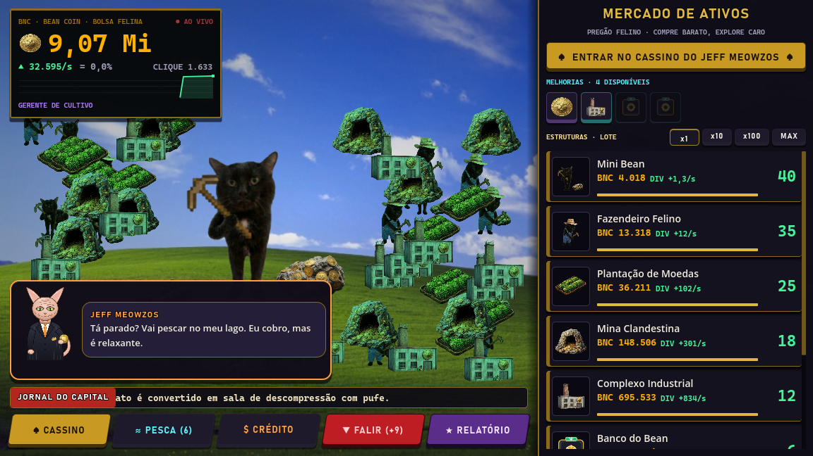
*Figura 1 — Tela principal: HUD de cotação, Grande Bean, estruturas no cenário, Jeff Meowzos ambulante, Jornal do Capital, barra de ações (com Pescaria) e Mercado de Ativos.*

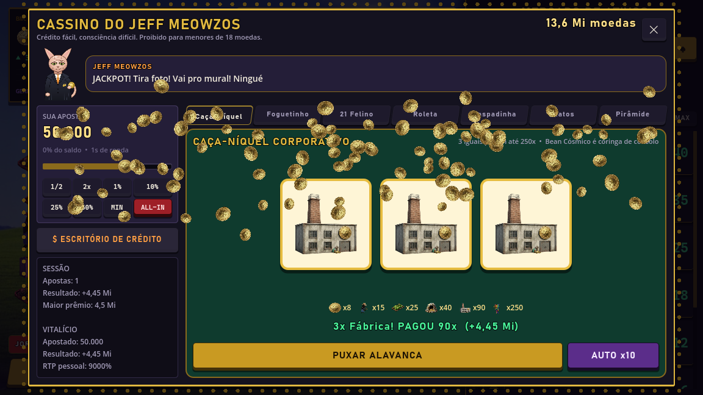
*Figura 2 — Cassino do Jeff Meowzos, Caça-Níquel: jackpot de 3 Fábricas pagando 90x, com chuva de moedas.*

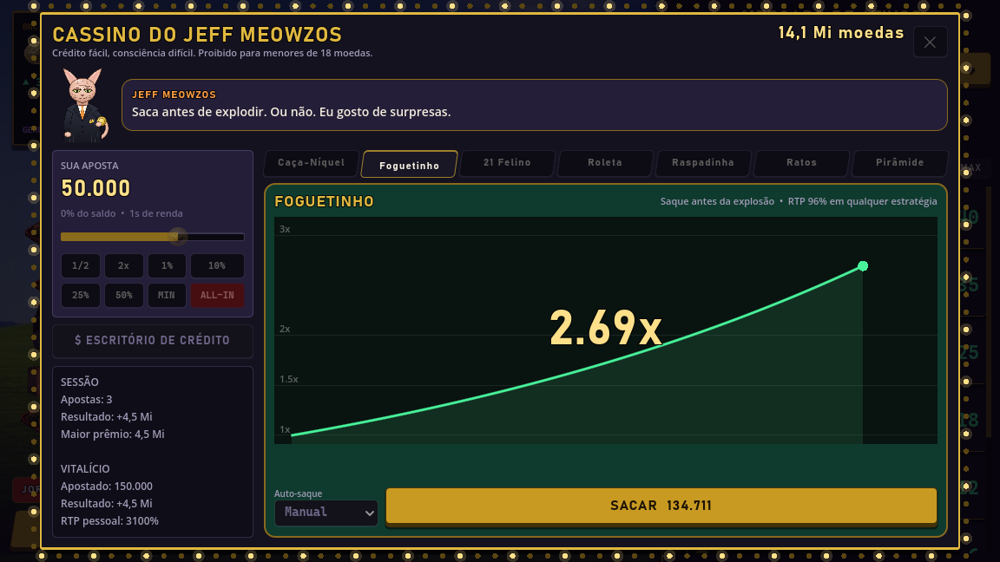
*Figura 3 — Foguetinho em voo, com gráfico ao vivo e auto-saque.*

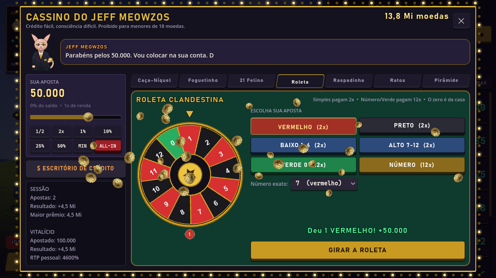
*Figura 4 — Roleta Clandestina com apostas de cor, faixa e número.*

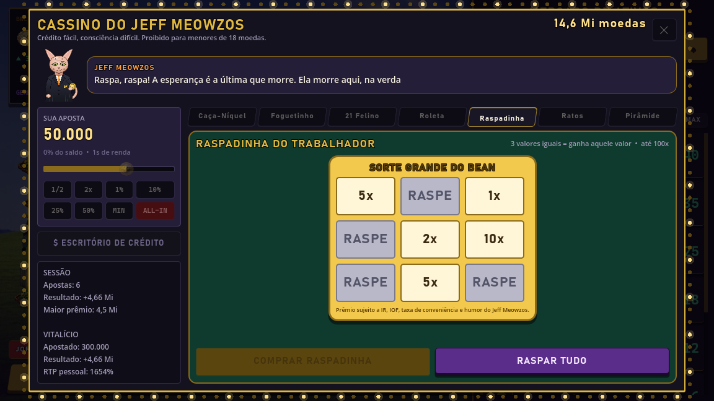
*Figura 5 — Raspadinha do Trabalhador sendo raspada.*

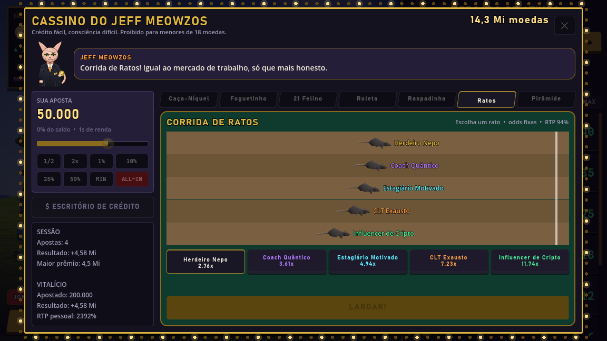
*Figura 6 — Corrida de Ratos em andamento.*

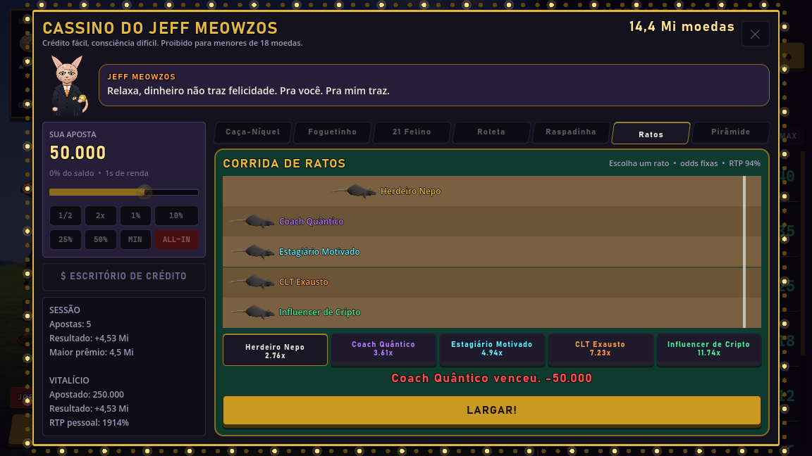
*Figura 7 — Esquema Pirâmide no nível 4.*

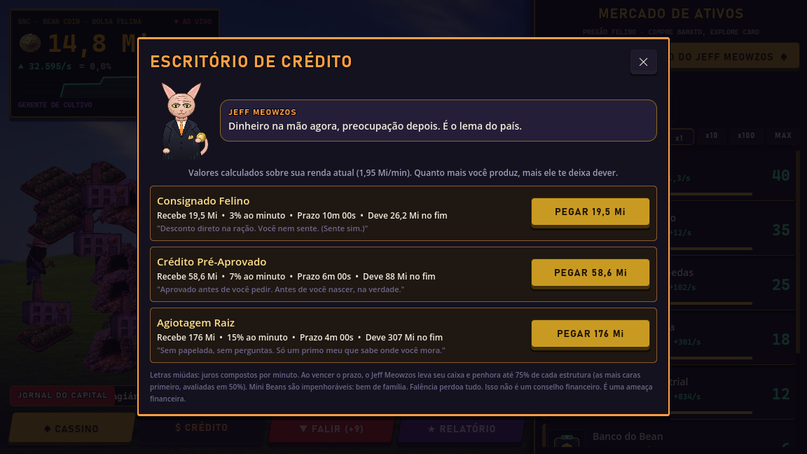
*Figura 8 — Escritório de Crédito do Jeff Meowzos com as três ofertas.*

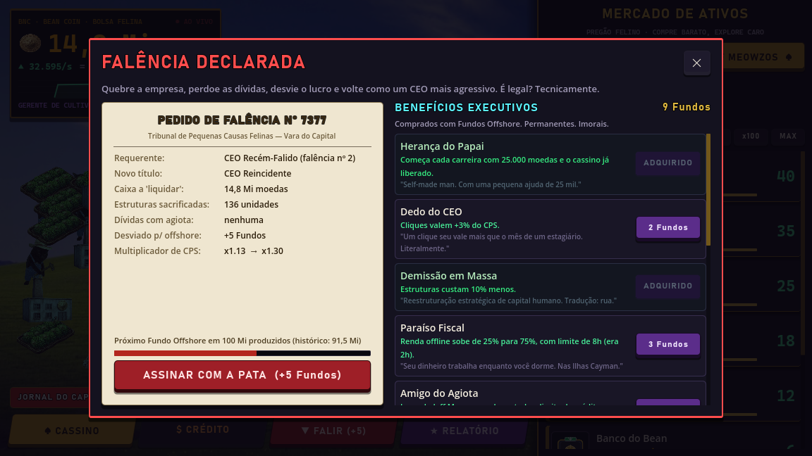
*Figura 9 — Falência Declarada: pedido de falência e Benefícios Executivos.*

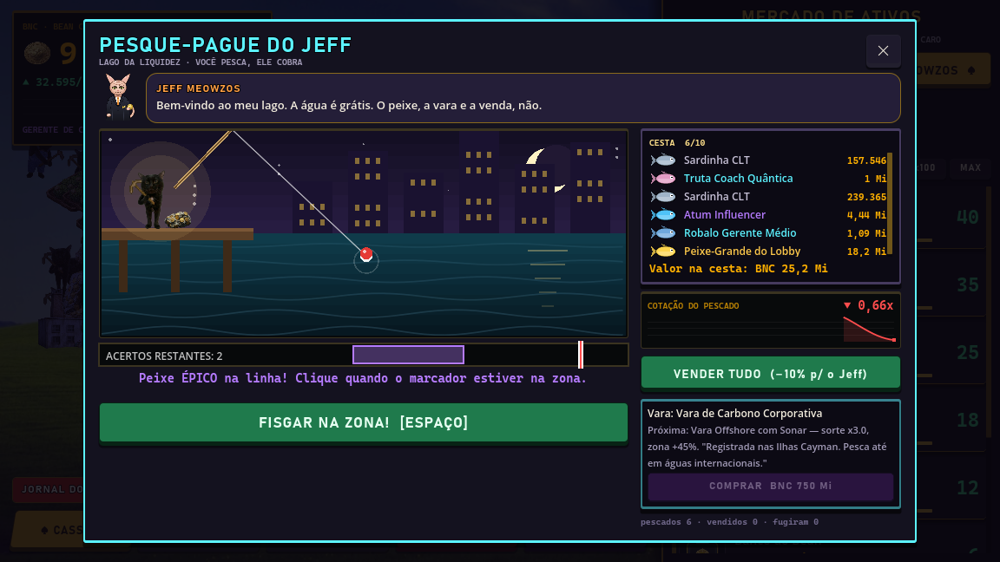
*Figura 10 — Pesque-Pague do Jeff: peixe Épico na barra de tensão, cesta com peixes de todas as raridades e a Cotação do Pescado.*

---

## 14. ARQUITETURA DE SOFTWARE

| Arquivo | Tipo | Responsabilidade |
| :--- | :--- | :--- |
| `GameManager.gd` | Autoload | Economia: moedas, estruturas, melhorias, Falência, benefícios, cassino, offline, autosave |
| `Meowzos.gd` | Autoload | Empréstimos e falas contextuais do Jeff Meowzos (sinal `said`) |
| `Fishing.gd` | Autoload | Pescaria: raridades, varas, cesta, cotação do pescado, valor escalado pela renda |
| `NumberFormatter.gd` | Autoload | Números no padrão brasileiro (1.234 / 1,23 Mi / Bi / Tri) |
| `SaveSystem.gd` | Utilitário | Save JSON v3 com migração do v2 |
| `data/GameData.gd` | Dados | Todos os números de balanceamento, textos, conquistas e manchetes |
| `ui/UIKit.gd` | Utilitário | Paleta, Theme global, fábricas de widgets e efeitos |
| `ui/ShopPanel.gd` | `PanelContainer` | Mercado de Ativos |
| `ui/PrestigeScreen.gd` | `Control` | Falência Declarada e Benefícios Executivos |
| `ui/LoanOffice.gd` | `Control` | Escritório de Crédito |
| `ui/AchievementsPanel.gd` | `Control` | Conquistas e "Relatório aos Acionistas" |
| `ui/FishingPanel.gd` | `Control` | Interface da pescaria: lago desenhado em código, barra de tensão, cesta e varas |
| `ui/Sparkline.gd`, `ui/Marquee.gd` | `Control` | Gráfico de cotação e letreiro de lâmpadas |
| `ui/NewsTicker.gd`, `ui/MeowzosBubble.gd` | `Control` | Jornal do Capital e balão do Meowzos |
| `Main.tscn` / `main.gd` | `Node2D` | Apresentação: HUD, Grande Bean, entidades, toasts |
| `BetsMenu.tscn` / `BetsMenu.gd` | `Control` | Moldura do cassino |
| `casino/*.gd` | `CasinoGame` | Um arquivo por mini-jogo |
| `BuildingEntity.tscn` | `Area2D` | Bonecos arrastáveis das estruturas |

---

## 15. EQUIPE & CONSIDERAÇÕES EXTENSIONISTAS

### 15.1. Integrantes
| Integrante | Atuação |
| :--- | :--- |
| **Abner** | Game Design, Balanceamento Numérico e Estruturas de Produção |
| **Athos** | Engenharia de Software, Arquitetura Godot 4 e Sistema de Save |
| **Lucas Scheibe** | Design de UI/UX, Interface Gráfica e Sistema de Apostas |
| **Raoni** | Lógica Matemática dos Mini-Jogos, Probabilidades e GameManager |
| **Ruan Vitor** | Arte Digital, Sprites, Animações de Tween e Partículas |
| **Vitor Kill** | Áudio/SFX, Documentação Técnica (GDD) e QA |

### 15.2. Impacto Extensionista (PAC)
*BeanClicker* contrasta a progressão estável da renda passiva com a volatilidade dos jogos de azar e com o custo real do crédito fácil. O jogo mostra abertamente o RTP de cada jogo, o RTP pessoal do jogador e quanto um empréstimo custa no fim do prazo. O humor torna visíveis mecanismos reais da indústria de apostas: o near-miss da raspadinha, o "reforço intermitente" das vitórias pequenas e a falácia do apostador.

---
*Documento atualizado para a versão 2.1 do BeanClicker.*
